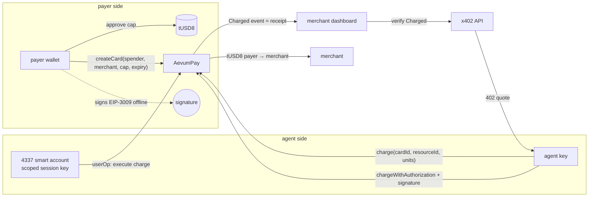

# AevumPay — metered agent payments with on-chain receipts

QDay Aevum testnet (chainId 44005, tUSD8) · Aevum Builder Challenge #1 · track: **Decentralized Payments**
Live app: **https://chichuzxy.github.io/aevum-pay/** · Contract: `0x6728d94b8e24960556f5a731761974a1774c3abe`

**中文摘要（5 行）**
给 AI agent 一张「有额度、有到期、可撤销」的会话卡；agent 按次付费调 API，payer 可以零 gas（EIP-3009 签名），
所有扣款在链上留收据，商户看板可直接对账。已实现 x402 闭环（402 → 上链 → 校验 → 发货）、4337 会话密钥（只能 charge）、
可复用 SDK 与四屏前端。实测：单次结算 1.08e-4 tQDAY、区块间隔 1s、校验 180ms，1 tQDAY ≈ 9,200 次计量调用。

---

## 1. What this is

AevumPay gives an agent a **budget it cannot exceed** and gives the merchant **a receipt that
cannot be faked**. Three things happen on-chain:

1. **Session card** — payer opens a card bound to one merchant, one spender (the agent), a spend
   cap and an expiry. One transaction, revocable at any moment.
2. **Metered charge** — every API call settles one `charge`; the contract prices the units,
   moves tUSD8 payer → merchant and refuses anything past the cap or the expiry.
3. **Receipt** — `Charged(cardId, resourceId, payer, merchant, units, amount, receiptHash,
   receiptIndex)` is the invoice line. The merchant dashboard reads it; anyone can audit it.

## 2. Problem

Agents pay for APIs, compute and data per request. Today that is done one of two ways:

| today | what breaks |
| --- | --- |
| raw `transfer` per call | no budget control, no invoice, no way to stop a runaway agent |
| prepaid balance inside one vendor's database | not verifiable, not portable, the buyer cannot audit spend |

Card rails cannot fill the gap: Stripe charges 2.9% + $0.30 per transaction, so a $0.01 API call
would pay **3,000%** of its value in fees. Metered, sub-cent settlement needs a rail where the
marginal cost of a payment rounds to zero.

## 3. How it works



Contract surface (v2, 3,189 bytes):

| function | who calls it | what it enforces |
| --- | --- | --- |
| `registerMerchant`, `listResource(resourceId, unitPrice)` | merchant | only listed prices are chargeable |
| `createCard(spender, merchant, cap, expiry, salt)` | payer | cardId is derived, not assigned |
| `charge(cardId, resourceId, units, receiptHash)` | spender | cap, expiry, merchant binding, resource active |
| `chargeWithAuthorization(..., Authorization)` | spender | same guards + EIP-3009 signature bound to card & amount |
| `revokeCard(cardId)` | payer or spender | takes effect on the next charge |
| `remaining(cardId)`, `cards(cardId)`, `receiptCount()` | anyone | dashboard needs no indexer |

## 4. Workflow (end to end, all measured)

```
payer                         agent                        merchant API
  │  approve 0.05 tUSD8         │                              │
  │  createCard ────────────────┼─────────────────────────────▶│  (card bound to merchant)
  │                             │  GET /infer ────────────────▶│
  │                             │◀────────── 402 + quote ──────│
  │                             │  charge(cardId, resource, 1) │
  │                             │──────────▶ AevumPay ─────────│ (payer −0.01, merchant +0.01)
  │                             │  GET /infer  X-PAYMENT: tx ─▶│
  │                             │                              │  verify Charged on-chain
  │                             │◀────────── 200 + result ─────│
```

Three settlement modes, one set of guards:

| mode | who signs | who pays gas | when to use |
| --- | --- | --- | --- |
| `charge` | agent (spender) | agent | autonomous agent, payer approved the cap once |
| `chargeWithAuthorization` | payer, offline (EIP-3009) | agent | payer holds no tQDAY, still approves every payment |
| 4337 `userOp` | session key (agent) | agent / relayer | payer wants a smart account with a scoped key |

## 5. What is new here

- **A budget primitive, not a risk filter.** The card is the unit of authorisation: cap, expiry,
  one merchant, one spender. The agent cannot overspend even if its key leaks, and the payer can
  revoke mid-flight.
- **Receipts as the integration point.** Every charge is an event with a stable index, so a merchant
  dashboard and a payer audit read the same source of truth — no indexer, no database.
- **Gasless is a mode, not a marketing line.** EIP-3009 `ReceiveWithAuthorization` means the payer
  signs once per payment and never needs native gas. Verified: during the charge the payer's
  transaction count and tQDAY balance are unchanged.
- **The session key is scoped on-chain.** With ERC-4337 v0.7 the account's session key can call
  exactly `AevumPay.charge` and nothing else — a `token.transfer` with the same key is rejected.

## 6. Platform fit (what we use on QDay, and what we don't)

| platform fact | what we did |
| --- | --- |
| tUSD8 is 6-decimal and implements **EIP-3009** | gasless settlement; the EIP-712 domain (`name=tUSD8, version=2, chainId=44005`) was derived and asserted against the token's `DOMAIN_SEPARATOR` |
| **EntryPoint v0.7 is deployed** (`0x0000000071727De22E5E9d8BAf0edAc6f37da032`, 16,035 bytes) | `SessionKeyAccount` + a scoped session key; userOps relayed by a plain script (no bundler needed) |
| **Shanghai EVM** (no `MCOPY`/`TSTORE`/blob ops) | `evm_version = "shanghai"`, checked with the starter kit's `check-shanghai.mjs` |
| `eth_getLogs` capped at 1,000 blocks | receipts read in 1,000-block chunks from the deploy block |
| no WebSocket RPC, explorer cannot verify sources | polling over HTTPS; this repo + deploy tx are the source-of-truth evidence |
| **ERC-8004 registries are absent on 44005** (size 0 at the canonical addresses) | we deliberately do not build on ERC-8004 identity; the card itself is the identity scope |

## 7. Evidence — every claim has a transaction

| what | value |
| --- | --- |
| AevumPay v2 | `0x6728d94b8e24960556f5a731761974a1774c3abe` — deploy tx `0xc9bb01135d4f738ad85ed0d6e8cd6b6653eb83189f06472bb7ef41c266230a7c`, block 3326369, 744,129 gas, runtime 3,189 bytes |
| SessionKeyAccount | `0xfa36b0c170cb9bd020610350986d27e11b4c2fc1` — 596,162 gas |
| card + charge inside cap | `0x0cd060df64ac4fe88f1c188bc5090f21c623fece43dd090753a1ffcc7b8be505` blk 3326773 |
| charge beyond cap → status 0 | `0x56ba9293b486f4c4b1fbe76d4b13c6fd0bda7b7577ebfee88951a837925c5255` (`CapExceeded`) |
| revoke, then charge → status 0 | `0xd812b4becbbf3d9c54efe8d7cdf9ff368a6121d63a7c1beedd443672de5350c9` / `0x8374bbed84018590ad3fb1e7561923470152dceaadb45f1369162203835bd87a` (`CardRevokedErr`) |
| gasless EIP-3009 charge | `0x498ee239f52d2995cc02b1c04a8feb19b774e95c75af04739f8e124f9fd14b15` blk 3337951, 151,036 gas, payer nonce 15→15 |
| x402 paid calls (5) | `0xe656740f…8489f`, `0x4ec7766a…4f721`, `0x9f25161d…9783`, `0x776ebb16…3d2e27`, `0xd215dbb1…c826685` |
| x402 over-budget | `0x139e701c7c2fc81d3037860ff758695913b5b3774256039ab8f15f3a2268bd51` status 0 |
| 4337 userOp pays a call | `0xbda27b640a523a2d419de93076bc3e068de7d1ed11177639ab20f3209092fcf3` 210,899 gas |
| 4337 session key tries `transfer` | `0xeecda1415d1736e267d9a1e87c60c827327774d46245c8b72104f56bf96c1826` status 0 |

Machine-written evidence: `evidence/x402-*.jsonl` (one line per step: ms, gas, receipt index).
CI: 20 Foundry tests + 5 SDK tests, green on every push.

**Evidence layers — these do not replace each other.**
`forge test` proves the contract logic; the testnet transactions above prove the flow works on QDay;
the JSONL proves what this run measured. Historical runs in the project log are reference only and are
not presented as part of any current demo. Nothing here is mainnet.

## 8. Security, trust, and what is *not* done

| feature | enforced where | current limit |
| --- | --- | --- |
| spend cap | contract (`CapExceeded`) | per card; a new card needs a new approval |
| expiry | contract (`CardExpired`) | block-time based, one day in the demos |
| instant revoke | contract (`CardRevokedErr`) | affects future charges only — a tx already mined cannot be undone |
| spender binding | contract (`SpenderMismatch`) | the spender key is a raw key in the demos, a session key in the 4337 demo |
| merchant binding | contract (`MerchantMismatch`) | one merchant per card (multi-merchant cards are roadmap) |
| signature replay | token nonce + `keccak(this, cardId, amount, salt)` | the salt must be fresh; the SDK generates one per charge |
| scoped agent key | `SessionKeyAccount.validateUserOp` (4337) | one selector, one target, one expiry window |
| merchant-side receipt check | `demo/x402/merchant.mjs` | in-memory "already spent" set; a restart would re-accept an old tx (chain state is still correct) |
| inference result | `aevum-stub-1` | **deterministic stub** — the model is fake, the payment is real |
| dashboard | static page reading `Charged` | no auth, no multi-tenant, no webhooks |

Not claimed: production readiness, audit, mainnet, or that the stub is an AI. The contracts are
MIT-licensed, unaudited, and built inside the hackathon window.

## 9. Who it is for

1. **AI API vendors** (inference, OCR, TTS, search) that bill per request and reconcile invoices weekly.
2. **Agent platforms / marketplaces** that hand keys to agents with no spend ceiling.
3. **Compute and GPU marketplaces** that settle per second and need receipts.
4. **Data vendors** selling per row, where chargebacks and reconciliation dominate support cost.

## 10. Roadmap

| window | next |
| --- | --- |
| 30 days | persistent receipt store + webhooks on the merchant side; paymaster so the agent's gas is sponsored too |
| 60 days | multi-merchant cards, refunds as on-chain credits, dashboard auth |
| 90 days | mainnet (QDay launches February), x402 client published as an npm package, ERC-4337 bundler service |

---

## Repository layout

```
src/AevumPay.sol              session cards, priced resources, metered charge, receipts
src/SessionKeyAccount.sol     ERC-4337 v0.7 account with a scoped session key
test/                         20 Foundry tests (contract + account)
script/Deploy.s.sol           broadcast deploy
sdk/                          @aevum-pay/sdk — cards, EIP-3009 signing, chunked receipts
web/                          four-screen static app (open / cards / pay / merchant)
demo/run.sh                   three-transaction demo (success + on-chain reverts)
demo/x402/                    merchant API with a 402 challenge + paying agent
scripts/gasless-demo.mjs      EIP-3009 gasless proof
scripts/4337-demo.mjs         session key userOp + a rejected misuse
docs/BUSINESS.md              unit economics, buyers, honest limits
docs/PRACTICE.md              runbook for rehearsing the demo before recording
docs/RECORDING.md             shot list for the 2.5-minute video
docs/VIDEO.md                 how the video is assembled (segments + narration, no drift)
docs/VIDEO-PLAN.md            narration script per segment (EN) + zh subtitles + TTS plan
video/build.mjs               deterministic assembly: normalise, sync per narration, subs, mix
evidence/                     machine-written JSONL from the demo runs
```

## Run it

```bash
forge test                     # 20 tests
npm i viem && npm run test:sdk # 5 SDK tests

cp .env.example .env           # your payer key, filled by you, never committed
bash demo/run.sh               # three txs: inside cap, over cap, after revoke

node scripts/gasless-demo.mjs  # EIP-3009: payer signs offline, agent pays gas
node demo/x402/setup.mjs       # x402: three roles + a fresh card
node demo/x402/merchant.mjs    # terminal 1
node demo/x402/agent.mjs       # terminal 2
forge build && node scripts/4337-demo.mjs   # session key userOp
```

Web app: `python -m http.server 8123` from the repo root, then open `/web/` — or use the
live link at the top.

## Gotchas found while building (kept because they will bite the next person)

1. `vm.envUint("PRIVATE_KEY")` needs a `0x` prefix; a bare 64-hex key reverts the deploy script.
2. Windows CRLF makes `forge fmt --check` fail the whole file in CI — `.gitattributes` forces LF.
3. ERC-4337 **v0.7** `PackedUserOperation.nonce` is `uint256` (v0.6 used `bytes32`). With the wrong
   type the account's `validateUserOp` selector becomes `0xaa45b2dc` instead of `0x19822f7c`, and the
   EntryPoint reverts `AA23 reverted` — it looks like a signature bug, it is ABI drift.
4. QDay's RPC drops idle TLS after ~5 s; the demo processes ping every 2 s so the printed latency
   measures the chain. RPC responses carry no revert data, so failed userOps must be replayed on a
   local fork to read the reason.
5. The explorer does not verify sources yet — the repo plus the deploy tx are the evidence.
