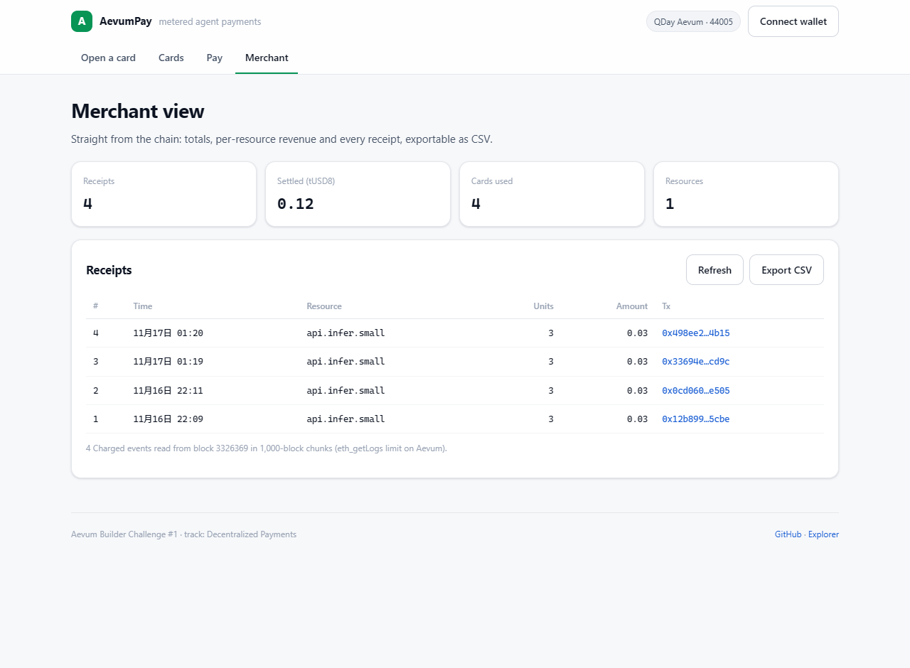
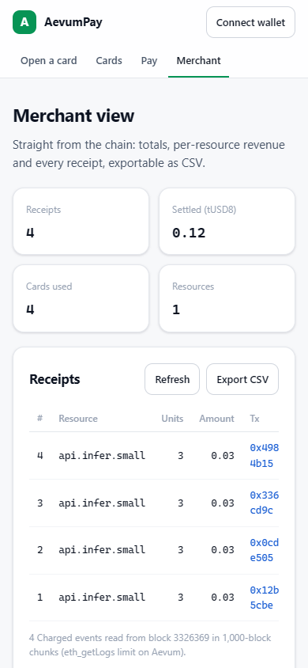

# AevumPay — metered agent payments with on-chain receipts

Aevum Builder Challenge #1 · Track: **Decentralized Payments** · QDay testnet (chainId 44005, tUSD8)

## Problem

AI agents pay for APIs and compute per request. Today each call is either a raw
`transfer` (no budget control, no invoice) or a prepaid balance inside one vendor's
database (not verifiable, not portable). Merchants cannot prove revenue; payers
cannot audit spend per session.

## What AevumPay adds

1. **Session card** — the payer opens a card bound to a merchant, a spender (the
   agent key), a spend cap and an expiry. The agent can charge only inside those
   limits; the payer can revoke at any time.
2. **Metered charge** — one on-chain call per settled batch of units; the contract
   prices the units, moves tUSD8 payer → merchant and enforces the cap.
   Two settlement paths share the same checks:
   - `charge` — approve + transferFrom (2 txs, payer pays gas);
   - `chargeWithAuthorization` — **gasless**: the payer signs an EIP-3009
     `ReceiveWithAuthorization` (tUSD8 supports it), the agent submits it, and the
     payer needs zero gas. The nonce is `keccak256(address(this), cardId, amount, salt)`,
     so a signature can never be replayed onto another card, price or merchant.
3. **On-chain receipt** — every charge emits `Charged(... receiptHash, receiptIndex)`,
   giving an append-only, verifiable reconciliation trail for the merchant dashboard
   and the payer's audit log.

Caps here are *business* limits that sit on top of the platform's ERC-4337 session
keys (spending cap / time lock enforced by the EntryPoint), not a replacement.

## Flow

```
payer ──approve──▶ AevumPay
payer ──createCard(spender=agent, merchant, cap, expiry)──▶ AevumPay
agent ──charge(cardId, resourceId, units, receiptHash)────▶ AevumPay ──tUSD8──▶ merchant
                                                   └─ Charged event = receipt
```

## Layout

```
src/AevumPay.sol        merchant registry, priced resources, session cards, metered charge, receipts
test/AevumPay.t.sol     6 tests: metering, cap, expiry, spender auth, revoke, merchant binding
script/Deploy.s.sol     broadcast deploy (reads PRIVATE_KEY + TUSD8_ADDRESS from .env)
```

## Network

| item | value |
| --- | --- |
| chainId | 44005 |
| RPC | https://rpc-test.qday.info |
| explorer | https://explorer-test.qday.info/ |
| tUSD8 | `0x456569838f1d43009A91ebA4263147Afd7233483` (6 decimals) |
| gas token | tQDAY |

## Run

```bash
cp .env.example .env      # fill PRIVATE_KEY yourself, never commit it
forge test -vv
forge script script/Deploy.s.sol:Deploy --rpc-url qday --broadcast
```

Deployment address and tx hash are recorded in the project's on-chain log
(`02_链上记录`) outside this repo, and in `broadcast/Deploy.s.sol/44005/`.

## Demo (one card, real transactions)

```bash
cp .env.example .env   # payer key, filled by you
# .env.demo holds a throwaway agent key (gitignored)
bash demo/run.sh
```

`demo/run.sh` funds the agent with 0.05 tQDAY, registers it as a merchant, lists
`api.infer.small` at 0.01 tUSD8/unit, opens a 0.05-cap 1-day card, then:

| step | result |
| --- | --- |
| charge 3 units (0.03) | status 1 — merchant paid, `Charged` receipt #2 |
| charge 4 units (0.04) | status 0 — revert `CapExceeded` (0xa4875a49) at block 3326803 |
| payer `revokeCard` | status 1 — block 3326811 |
| charge 1 unit after revoke | status 0 — revert `CardRevokedErr` (0x9c051178) at block 3326819 |

Failing cases are forced on-chain with `--gas-limit`, so they leave status-0
transactions as evidence instead of being rejected client-side.

### Gasless proof (EIP-3009)

```bash
npm i viem
node scripts/gasless-demo.mjs
```

The payer signs a `ReceiveWithAuthorization` offline; the agent broadcasts
`chargeWithAuthorization` and pays the gas. The script asserts the local EIP-712
domain against the token's `DOMAIN_SEPARATOR` and prints the before/after nonce and
tQDAY balance of the payer:

```
payer tx count : 15 -> 15   (unchanged = payer sent nothing)
payer tQDAY    : 5899143950988400544 -> 5899143950988400544   (unchanged = payer paid no gas)
merchant tUSD8 : 0.09 -> 0.12
tx 0x498ee239f52d2995cc02b1c04a8feb19b774e95c75af04739f8e124f9fd14b15 (block 3337951, gas 151,036)
```

## Web UI (no build step)

```bash
python -m http.server 8123        # from the repo root
# open http://localhost:8123/web/
```

A single-page app (viem from a CDN, the rest is our SDK) with four screens:
**Open a card** (resource quote → cap → expiry → approve+createCard),
**Cards** (remaining budget, expiry, receipts, one-click revoke),
**Pay** (agent quotes, payer signs EIP-712 in the wallet — no gas — then the agent
submits), **Merchant** (totals, per-resource revenue, receipts, CSV export).




Every number comes from the chain (`cards()`, `Charged` events read in 1,000-block
chunks) — no database, no backend.

## SDK — `@aevum-pay/sdk`

`sdk/` is a dependency-light ESM package (viem as peer) so other builders can reuse
the rail instead of re-deriving it:

```js
import { createAevumPay } from "@aevum-pay/sdk";
const pay = createAevumPay();                       // 44005 defaults
const { cardId } = await pay.openCard(payer, {...}); // approve + createCard
const { amount, auth } = await pay.prepareGasless({ payerAccount: payer, cardId, resourceId, units: 3n, salt, validBefore });
await pay.chargeWithAuthorization(agent, { cardId, resourceId, units: 3n, receiptHash, auth });
const rows = await pay.receipts({ fromBlock: 3326369 }); // chunked for the 1,000-block log cap
```

`npm run test:sdk` covers cardId / nonce / domain-separator derivation (5 tests, no network).

## Deployed (QDay Aevum testnet, chain 44005)

| | |
| --- | --- |
| AevumPay v2 (EIP-3009 gasless) | `0x6728d94b8e24960556f5a731761974a1774c3abe` |
| deploy tx | `0xc9bb01135d4f738ad85ed0d6e8cd6b6653eb83189f06472bb7ef41c266230a7c` (block 3326369, gas 744,129) |
| AevumPay v1 (approve only, superseded) | `0x41be9eb9035a25bd3869c30eeee6989e5c68830e` |

## Aevum specifics (from the official starter kit)

- **Shanghai EVM**: no `MCOPY`/`TSTORE`/blob opcodes. `evm_version = "shanghai"` is pinned;
  the kit's `check-shanghai.mjs` reports both bytecode blobs Shanghai-safe.
- `eth_getLogs` is capped at 1,000 blocks → chunk log scans from the deploy block.
- No WebSocket RPC → poll over HTTPS.
- Explorer source verification is not open yet → this repo + the tx above are the evidence.
- Legacy (type 0) transactions work; the kit's scripts send `--legacy`.

## Status

v2 deployed and demoed end-to-end: session cards, metered charges (approve + EIP-3009
gasless), on-chain receipts, reusable SDK. 10/10 Foundry tests, 5/5 SDK tests, CI green.
Next: merchant dashboard / minimal UI reading `Charged` events, 2-3 min demo video,
submission pack.
